# CompStellation

<!-- badges: start -->
[](https://github.com/kadenmuffett/CompStellation/actions/workflows/R-CMD-check.yaml)
<!-- badges: end -->

The `CompStellation` package provides interpretable star (radar) plots for compositional and multidimensional ecological data in R using `phyloseq` and `ggplot2`. Its core features replace standard points or stacked bars with multidimensional star polygons showing the relative abundance of focal or core taxa (`plot_taxa_star()`, `plot_core_matrix()`, `plot_concordant_core()`) or group centres across several ordination axes simultaneously (`plot_ordi_star()`, `plot_ordi_star_iris()`).


*Group ordination positions on the first five PCoA axes (`plot_ordi_star()`)*

Transparency note! I used Gemini and Claude to help identify and fix inconsistencies in the readme and between subcommands, as well as design tests to make sure the package functions properly.

## Installation

`CompStellation` depends on `phyloseq` (Bioconductor), so install `phyloseq` first if it is not already installed:

```r
if (!requireNamespace("BiocManager", quietly = TRUE)) install.packages("BiocManager")
if (!requireNamespace("remotes", quietly = TRUE)) install.packages("remotes")

BiocManager::install("phyloseq")
remotes::install_github("kadenmuffett/CompStellation")
```

## Input Data Formats & Preparing Your Own Data

`CompStellation` accepts two input formats:

### 1. A `phyloseq` object (all functions)
All six exported functions accept a `phyloseq` object (from the Bioconductor `phyloseq` package), which bundles three aligned tables:
- **`otu_table`**: A numeric matrix of read counts or relative abundances (taxa as rows or columns, identified by `taxa_are_rows`).
- **`tax_table`**: A character matrix mapping each taxon/ASV ID (rownames) to hierarchical taxonomic ranks (columns such as `"Kingdom"`, `"Phylum"`, `"Class"`, `"Order"`, `"Family"`, `"Genus"`).
- **`sample_data`**: A data frame of sample metadata where rownames match the sample IDs in the `otu_table`, containing grouping columns (`sample_var` / `group_var`) and a sample identifier column (`samplecolumn`).

To build a `phyloseq` object from your own count matrix (`counts_mat`), taxonomy matrix (`tax_mat`), and metadata data frame (`meta_df`):

```r
library(phyloseq)

# counts_mat: numeric matrix (rows = ASVs/OTUs, cols = sample IDs)
# tax_mat:    character matrix (rownames = ASVs/OTUs, colnames = taxonomic ranks)
# meta_df:    data.frame (rownames = sample IDs, plus sample ID & grouping columns)
ps <- phyloseq(
  otu_table(counts_mat, taxa_are_rows = TRUE),
  tax_table(as.matrix(tax_mat)),
  sample_data(meta_df)
)
```

### 2. Converting a `vegan`-style `data.frame` (`vegan_to_phyloseq()`) or plotting a wide `data.frame` directly
For users working with `vegan`-style sample-by-taxon tables (samples in rows, taxa in columns), `vegan_to_phyloseq()` converts either a combined wide `data.frame` or a separate community matrix + metadata table into a `phyloseq` object ready for every `CompStellation` function. In addition, `plot_taxa_star()` accepts a wide `data.frame` directly:

```r
df_example <- data.frame(
  SampleID    = paste0("S", 1:6),
  Habitat     = rep(c("Reef", "Lagoon"), each = 3),
  Bacteroidia = c(40, 35, 45, 15, 20, 10),
  Clostridia  = c(30, 25, 20, 50, 45, 55),
  Gammaprot   = c(20, 30, 25, 25, 25, 20),
  OtherTaxa   = c(10, 10, 10, 10, 10, 15)
)

# Convert to a phyloseq object for use across all CompStellation functions
ps_from_df <- vegan_to_phyloseq(
  df         = df_example,
  sample_col = "SampleID",
  taxa_rank  = "Class"
)

# Or pass the wide data.frame directly to plot_taxa_star()
plot_taxa_star(
  physeq       = df_example,
  sample_var   = "Habitat",
  samplecolumn = "SampleID",
  taxa_rank    = "Class",
  taxa_names   = c("Bacteroidia", "Clostridia", "Gammaprot")
)
```
#NB: the data.frame as input without conversion works *only with taxa star*. Use conversion for all other functions.

## Built-in Datasets

`CompStellation` ships with **`cassiopea_ps`** (`data("cassiopea_ps")`), a 16S rRNA microbiome `phyloseq` object of the upside-down jellyfish (*Cassiopea xamachana*) and its surrounding environment across 8 sites in the Florida Keys (3,000 ASVs across 76 samples, grouped by `Body_cav`: `Bell`, `GVC` [gastrovascular cavity], `Sub` [substrate], and `WTR` [water], with sample IDs in `Sample_NAME`). Examples can also be run with `GlobalPatterns` from `phyloseq`.

## Features & Examples

### 1. `plot_taxa_star()`
Creates star/radar plots showing the mean or median relative abundance of specified taxa (or the top 4 most abundant taxa automatically, up to 8) plus a pooled `"Other"` spoke across sample groups, with IQR or SE error bars.

```r
library(CompStellation)
library(phyloseq)

data("cassiopea_ps")

# Plot top 4 phyla across Cassiopea body compartments and environment
p_taxa <- plot_taxa_star(
  physeq         = cassiopea_ps,
  sample_var     = "Body_cav",
  taxa_rank      = "Phylum",
  samplecolumn   = "Sample_NAME",
  error_bar      = "SE",
  plot_order     = "hclust",
  axis_label_pos = "side",   # "side" (default), "middle" (12 o'clock), or "none"
  label_color    = "black"
)
print(p_taxa)
```

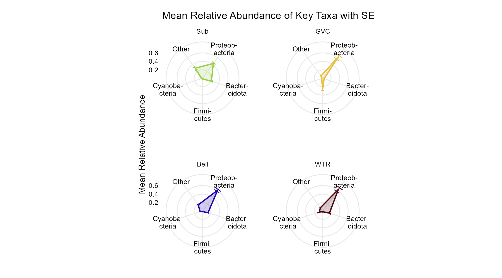

By comparison, when we produce bars of the same data, the distinctiveness of "GVC" can get a bit lost in the noise.

```r
cassiopea_rel <- phyloseq::transform_sample_counts(cassiopea_ps, function(x) x / sum(x))
phyloseq::plot_bar(cassiopea_rel, fill = "Phylum") +
  geom_bar(aes(color = Phylum, fill = Phylum), stat = "identity", position = "stack")
```

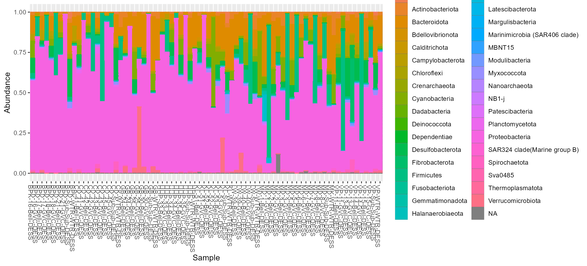

### 2. `plot_ordi_star()`
Runs an ordination (PCoA on Bray-Curtis dissimilarity by default, or any ordination object supplied via `ord`) and plots each group's centre on the first `n_axes` ordination axes as the spokes of a star plot.
While the distance defaults to bray, this may not be appropriate. Similarly, the hclust coloring of sample groups uses bray for speed and consistency. You can always pass colors manually.

```r
# Overlaid on a single radar
p_ordi_tog <- plot_ordi_star(
  physeq     = cassiopea_ps,
  sample_var = "Body_cav",
  distance   = "bray",
  view_type  = "together",
  error_bar  = "IQR"
)
print(p_ordi_tog)
```

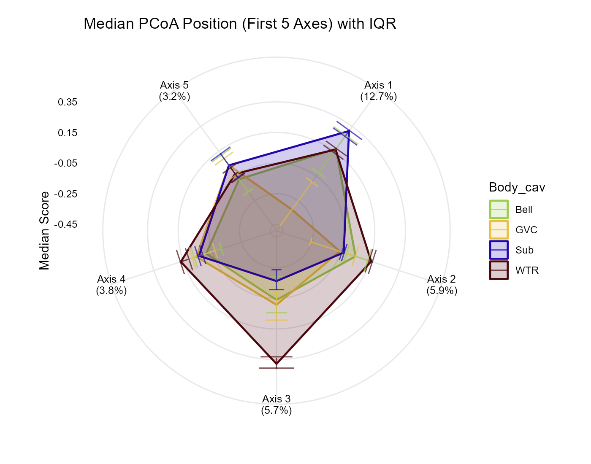

```r
# Faceted (one panel per group) with hierarchical clustering order
p_ordi_sep <- plot_ordi_star(
  physeq     = cassiopea_ps,
  sample_var = "Body_cav",
  distance   = "bray",
  view_type  = "separate",
  plot_order = "hclust"
)
print(p_ordi_sep)
```

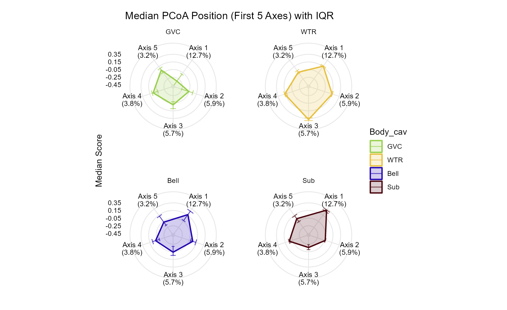

By comparison, a standard 2D ordination plot shows only the first two axes, where groups overlap even when they separate on higher axes (Axes 3–5). *(Note: `phyloseq`'s uncorrected negative eigenvalues inflate axis percentages relative to `plot_ordi_star()`.)*

```r
ord_bray <- phyloseq::ordinate(cassiopea_ps, method = "PCoA", distance = "bray")
phyloseq::plot_ordination(cassiopea_ps, ord_bray, color = "Body_cav") +
  geom_point(size = 2.5, alpha = 0.8) +
  theme_minimal()
```

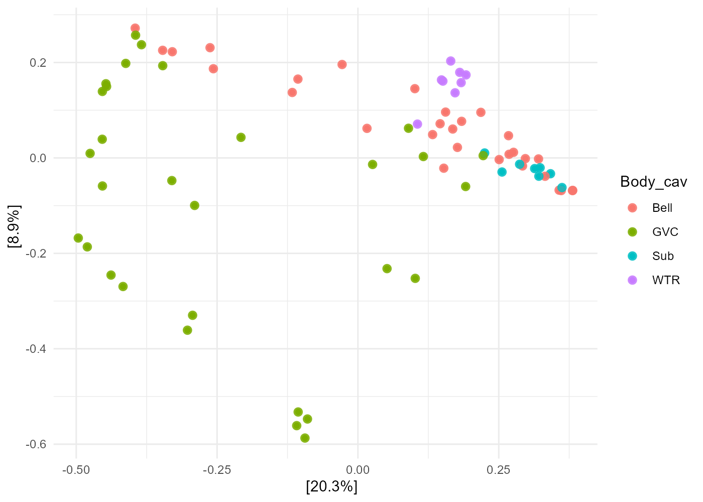

### 3. `plot_ordi_star_iris()` *(early experimental)*
Places the `plot_ordi_star()` radar at the centre of a circular stacked bar chart ("iris"), where each segment of the outer ring shows an individual sample's taxonomic composition. With under 10 samples per group the outside ring looks quite bad.

```r
p_iris <- plot_ordi_star_iris(
  physeq     = cassiopea_ps,
  sample_var = "Body_cav",
  taxa_rank  = "Phylum",
  distance   = "bray",
  view_type  = "separate"
)
print(p_iris)
```

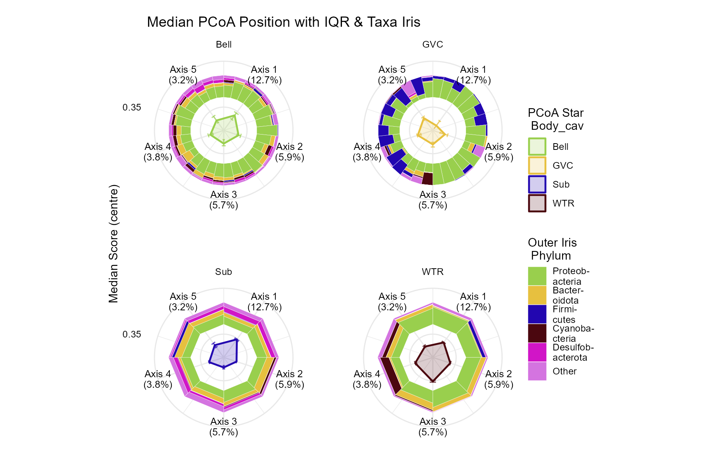

### 4. `coreselect()`
Identifies core taxa within each group (taxa exceeding `abundance_threshold` in at least `percent_samples` of that group's samples) and plots a presence/absence dot matrix across groups. The core taxon lists are attached as `attr(result, "core_list")`. 
Conceptually, this catches taxa that are core within treatment groups A | B | C

```r
p_core_dots <- coreselect(
  physeq              = cassiopea_ps,
  group_var           = "Body_cav",
  percent_samples     = 0.75,   # 75% prevalence
  abundance_threshold = 0.005,  # > 0.5% relative abundance
  abundance_type      = "relative"
)
print(p_core_dots)
lapply(attr(p_core_dots, "core_list"), head)
```

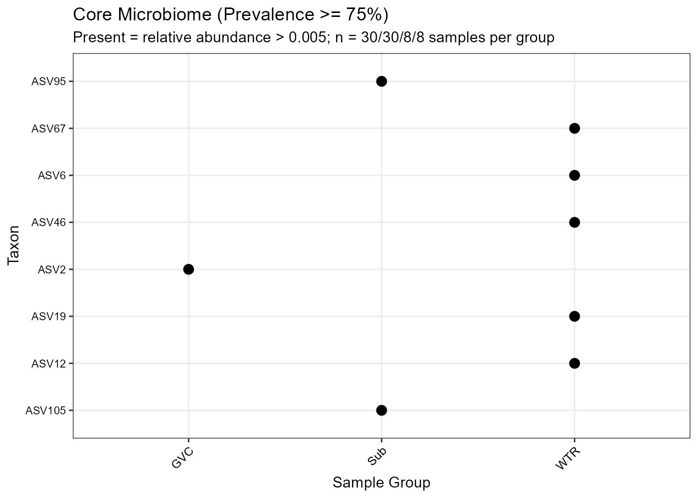

### 5. `plot_core_matrix()`
Identifies the **unique core** for each group (taxa in that group's core but absent from the core of all other evaluated groups; capped at the 3 most abundant unique core taxa per group) and generates a matrix of star plots where columns are each group's unique core and rows show how those taxa behave across every evaluated group.
Conceptually, this shows you the abundance of taxa that are core within treatment groups A | B | C, but no taxa in the 'core' of multiple treatments. The VERTICAL is the unique taxa from treatment X, the HORIZONTAL is the average abundance of that set of taxa in each category. 


```r
p_core_mat <- plot_core_matrix(
  physeq              = cassiopea_ps,
  group_var           = "Body_cav",
  percent_samples     = 0.85,
  abundance_threshold = 0,
  taxa_rank           = "Family",
  samplecolumn        = "Sample_NAME",
  group_subset        = c("Sub", "WTR"),
  log_scale           = TRUE
)
print(p_core_mat)

# Inspect the unique core memberships and underlying per-group prevalences
attr(p_core_mat, "unique_core")
```

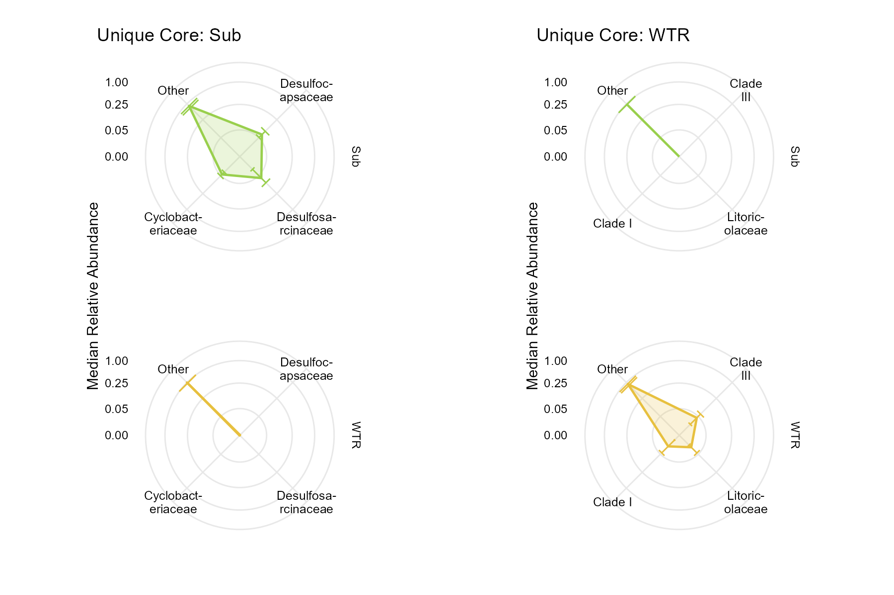

### 6. `plot_concordant_core()`
The complement of `plot_core_matrix()`: identifies the **concordant core** shared by *every* evaluated group (capped at `max_taxa`, default 5 most abundant shared core taxa) and plots their relative abundance as a star plot.

```r
p_concordant <- plot_concordant_core(
  physeq              = cassiopea_ps,
  group_var           = "Body_cav",
  percent_samples     = 0.5,
  abundance_threshold = 0,
  taxa_rank           = "Family",
  samplecolumn        = "Sample_NAME",
  group_subset        = c("Bell", "GVC"),
  max_taxa            = 3
)
print(p_concordant)
attr(p_concordant, "concordant_core")
```

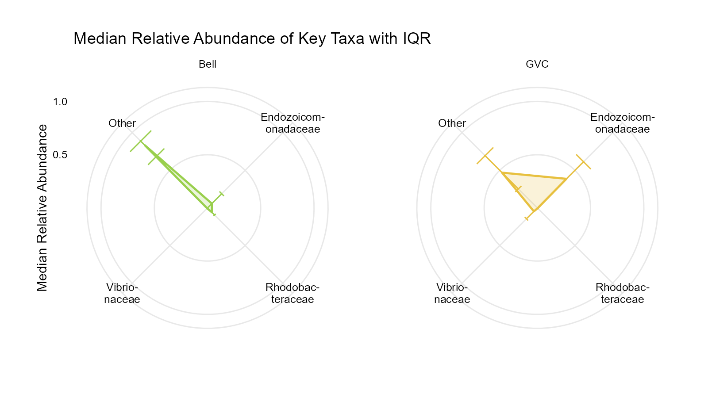

## Exporting Figures (`ggsave()`)

Because `CompStellation` functions return `ggplot` (or `patchwork`) objects, use `ggplot2::ggsave()` with explicit dimensions, `dpi = 300`, and a white background (`bg = "white"`) for publication-ready figures:

```r
library(ggplot2)

# Single or faceted star plots (plot_taxa_star, plot_ordi_star, plot_concordant_core)
ggsave("taxa_star.png", plot = p_taxa, width = 9, height = 5, units = "in", dpi = 300, bg = "white")

# Overlaid ordination star plot
ggsave("ordi_star.png", plot = p_ordi_tog, width = 7, height = 5.5, units = "in", dpi = 300, bg = "white")

# Multi-column core matrix (plot_core_matrix)
ggsave("core_matrix.png", plot = p_core_mat, width = 12, height = 8, units = "in", dpi = 300, bg = "white")
```

### Aesthetics! 
In order to produce publication rready graphs, having the ability to vary aesthetics is important. Using the parameter taxa_names, you can pass a set of taxa to display yourself. Using error_bar, choose whether IQR or SE makes more sense for your data. fill_alpha changes the transparency of the polygon. base_colors=c() lets you supply colors that hclust will lighten and darken across groups. colors_all=c() instead manually colors each category. show_caption lets you choose whether to display a caption about IQR/SE or not. label_color lets you choose ... well... label color. axis_label_pos lets you move the explanatory spoke position label. font lets you specify a font.

```r
library(CompStellation)
library(phyloseq)

data("cassiopea_ps")

# Plot top 4 phyla across Cassiopea body compartments and environment, this time with 
# incredibly strange aesthetic choices
p_taxa_2 <- plot_taxa_star(
  physeq         = cassiopea_ps,
  sample_var     = "Body_cav",
  taxa_rank      = "Phylum",
  samplecolumn   = "Sample_NAME",
  error_bar      = "none",
  axis_label_pos = "middle",   # "side" (default), "middle" (12 o'clock), or "none"
  label_color    = "orange",
  fill_alpha     = 1,
  colors_all     = c("black", "black", "lightgreen", "black"),
  font           = "serif"

)
print(p_taxa_2)
```

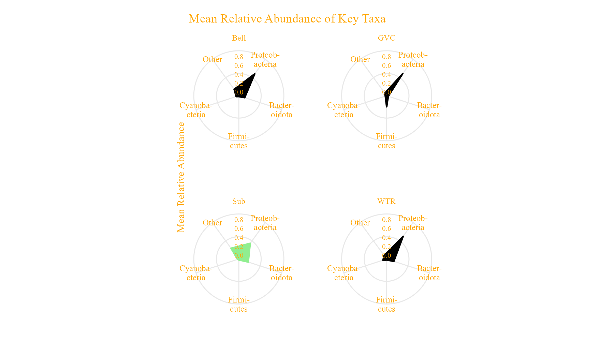

```r
p_taxa_3 <- plot_taxa_star(
  physeq         = cassiopea_ps,
  sample_var     = "Body_cav",
  taxa_rank      = "Phylum",
  samplecolumn   = "Sample_NAME",
  error_bar      = "SE",
  show_caption   = TRUE,
  axis_label_pos = "middle",   # "side" (default), "middle" (12 o'clock), or "none"
  label_color    = "orange",
  fill_alpha     = 0.2,
  colors_all     = "hclust",
  base_colors    = c("gold", "black", "lightgreen", "purple"),
  font           = "serif",
  plot_order     = "hclust"

)
print(p_taxa_3)
```

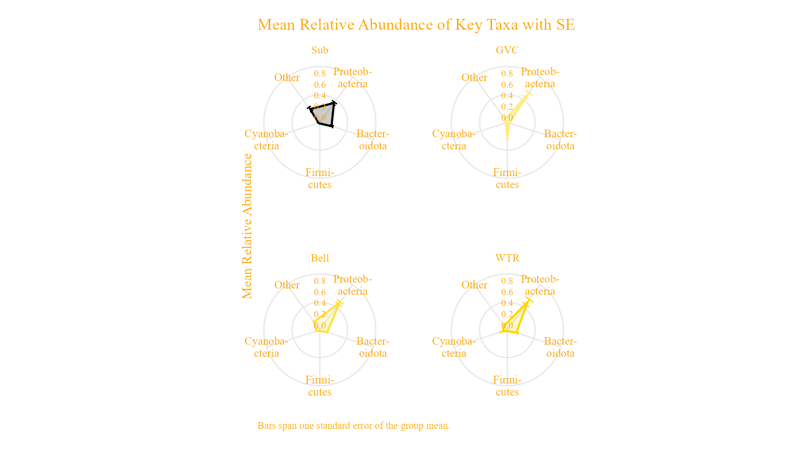


## Interpreting Star Plots

A few key points to keep in mind when reading and publishing these figures:

- **Area is not a quantity.** The area enclosed by a star polygon depends on the order of the spokes, so it changes if the axes are reordered even though no value has changed. Comparing spoke by spoke and dominance of single spokes is relevant, not by overall polygon size.
- **The radial axis in `plot_ordi_star()` is offset.** Ordination scores are negative as well as positive, so all axes are shifted by a single constant to make them plottable on a radius. Radii are therefore not proportional to the scores, and are not comparable between axes. The tick labels show the original (unshifted) values.
- **`error_bar = "IQR"` and `error_bar = "SE"` answer different questions.** The IQR describes the spread of samples within a group (and is drawn around the group median); the SE describes the uncertainty of the group mean (and is drawn around the mean). The plot title records which one was used.
- **The abundances are compositional.** Relative abundances within a sample sum to 1, so the spokes are not independent — a rise in one taxon mechanically depresses the others, and the `"Other"` wedge is often the largest single value.
- **These plots are descriptive.** They do not test whether groups differ. Pair them with an appropriate test (for example `vegan::adonis2()` on the same distance matrix) before making a claim about group separation!
- **Distance metric and compositionality.** `plot_ordi_star()` defaults to Bray-Curtis dissimilarity (`distance = "bray"`), which does not account for the compositional nature of metagenomic sequencing data. For compositional beta-diversity analyses, consider passing an Aitchison or CLR-transformed Euclidean ordination object directly via the `ord` argument.

## Getting Help

If you encounter a bug or have a feature request, please file an issue with a minimal reproducible example at <https://github.com/kadenmuffett/CompStellation/issues>.
